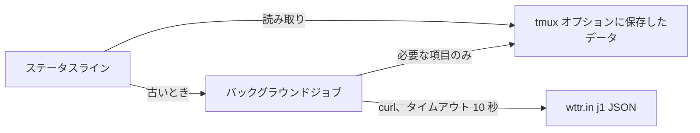

<div align="center">

# tmux-weather-revamped

<strong>wttr.inの天気をバックグラウンドで取得し、ステータスバーを待たせずに表示します。</strong>

[English](README.md) | 日本語 | [简体中文](README.zh-Hans.md) | [繁體中文（香港）](README.zh-HK.md)

[](https://github.com/tmux-revamped/tmux-weather-revamped/actions/workflows/family.yml)
[](https://github.com/tmux-revamped/tmux-weather-revamped/actions/workflows/tests.yml)
[](https://github.com/tmux-revamped/tmux-weather-revamped/releases/latest)
[](https://scorecard.dev/viewer/?uri=github.com/tmux-revamped/tmux-weather-revamped)
[](LICENSE)

<p align="center">
  <a href="#機能">機能</a> |
  <a href="#動作要件">動作要件</a> |
  <a href="#インストール">インストール</a> |
  <a href="#使い方">使い方</a> |
  <a href="#設定">設定</a> |
  <a href="#キーバインド">キーバインド</a> |
  <a href="#仕組み">仕組み</a>
</p>

</div>

**28**個のステータスのプレースホルダーを、地点ごとに**1**回のwttr.inへの要求から作ります。要求の間隔は既定で**15**分です。取得に失敗しても、最後に成功した値を表示し続けます。

---

## 機能

このプラグインは、指定した地点のwttr.inの`j1` JSONを切り離したバックグラウンドジョブで取得し、必要な項目だけをtmuxオプションに保存し、その保存済みのコピーからすべてのプレースホルダーを描画します。ステータスラインは保存済みのコピーを読むだけなので、ネットワークの状態にかかわらずすぐに返ります。

| プレースホルダー | 出力 |
|:------------|:-------|
| `#{weather}` | 天気と気温。例: `Partly cloudy +18°C` |
| `#{weather_temp}` | 先頭のプラス記号を除いた気温。例: `18°C` |
| `#{weather_feels_like}` | 体感温度。例: `16` |
| `#{weather_wind}` | 風速と風向。例: `11km/h NW` |
| `#{weather_humidity}` | 相対湿度、パーセント |
| `#{weather_pressure}` | 気圧、hPa |
| `#{weather_pressure_trend}` | 前回成功した取得と比べた`^`、`v`、`=` |
| `#{weather_precip}` | 降水量、ミリメートル |
| `#{weather_rain_chance}` | 今日の最初の8つの予報区間のうち最も高い降水確率 |
| `#{weather_umbrella}` | 降水確率がしきい値に達したときの傘の文字列 |
| `#{weather_uv}` | UV指数 |
| `#{weather_uv_color}` | UVの区分に応じたtmuxのスタイル |
| `#{weather_dew_point}` | 今日の最初の8つの予報区間の露点の平均 |
| `#{weather_dew_comfort}` | `dry`、`comfortable`、`humid`、`oppressive` |
| `#{weather_moon}` | 月齢。例: `Waning Gibbous` |
| `#{weather_sunrise}` | 日の出。例: `06:00 AM` |
| `#{weather_sunset}` | 日の入り。例: `06:45 PM` |
| `#{weather_forecast}` | 明日の最低と最高。例: `15-27` |
| `#{weather_today_high}` | 今日の最高気温 |
| `#{weather_today_low}` | 今日の最低気温 |
| `#{weather_tomorrow_high}` | 明日の最高気温 |
| `#{weather_tomorrow_low}` | 明日の最低気温 |
| `#{weather_condition_icon}` | 空模様を表すNerd FontのMaterial Designグリフ |
| `#{weather_condition_tint}` | 空模様に応じたtmuxのスタイル |
| `#{weather_color}` | 気温帯に応じたtmuxのスタイル。例: `#[fg=green]` |
| `#{weather_icon}` | 気温帯ごとのアイコン。設定するまで空 |
| `#{weather_stale_color}` | 最後に成功した取得が間隔の3倍より古くなると`#[dim]` |
| `#{weather_alert}` | 気象警報の1行。警報を有効にしない限り空 |

## 動作要件

| ツール | バージョン | 用途 |
|:-----|:--------|:---------|
| tmux | 3.2以降 | 詳細のポップアップが`display-popup`を使います |
| bash | 3.2以降 | macOSの`/bin/bash`で動きます |
| `curl` | 任意のバージョン | すべての取得。タイムアウトは10秒 |
| `wttr.in`へのネットワーク接続 | | 天気の取得元 |

CIは、Ubuntu LTSのx86_64とarm64でGNUとuutilsのcoreutilsを使い、macOSのApple SiliconとIntelでシステムのツール、GNUのツール、uutilsを使ってテストを実行します。

## インストール

[TPM](https://github.com/tmux-plugins/tpm)を使う場合は、プラグインとプレースホルダーを`~/.tmux.conf`に追加して`prefix + I`を押します。

```tmux
set -g @plugin 'tmux-revamped/tmux-weather-revamped'
set -g status-right '#{weather} '
```

TPMを使わない場合は、リポジトリをクローンし、`status-right`を設定した後でエントリーポイントを実行します。

```bash
git clone https://github.com/tmux-revamped/tmux-weather-revamped ~/.tmux/plugins/tmux-weather-revamped
```

```tmux
run-shell ~/.tmux/plugins/tmux-weather-revamped/weather-revamped.tmux
```

設定例の全体は[`examples/status-right.tmux.conf`](examples/status-right.tmux.conf)にあります。

## 使い方

地点を設定します。空にするとwttr.inがIPアドレスから位置を判断します。

```tmux
set -g @tmux-weather-location 'Sao Paulo'
set -g status-right '#{weather_color}#{weather_condition_icon} #{weather_temp}#[default] '
```

起動直後の最初の描画は、最初の取得が終わるまで空です。同じデータからさらにプレースホルダーを使えば、要求を増やさずに表示を充実させられます。

```tmux
set -g status-right '#{weather_temp} #{weather_wind} #{weather_humidity}%% UV#{weather_uv} #{weather_forecast} '
```

### 気温帯

`#{weather_color}`と`#{weather_icon}`は、現在の気温が属する気温帯のオプションを読みます。気温帯は表示の単位にかかわらず摂氏のしきい値を使います。

| 気温帯 | 範囲、°C | 既定の色 |
|:-----|:------------|:--------------|
| `freezing` | 0未満 | `#[fg=blue]` |
| `cold` | 0から9 | `#[fg=cyan]` |
| `cool` | 10から17 | `#[fg=green]` |
| `comfortable` | 18から23 | `#[fg=green]` |
| `hot` | 24から31 | `#[fg=yellow]` |
| `very_hot` | 32以上 | `#[fg=red]` |

各気温帯は`@weather_revamped_<band>_color`と`@weather_revamped_<band>_icon`を読みます。アイコンの既定は空なので、設定するまでNerd Fontは不要です。

### 空模様

天気の文字列は、次の順で調べる6つのキーのいずれかに対応します。そのため、雷を伴うにわか雨は嵐、みぞれは雪になります。

| キー | 天気の文字列に含まれる語 | 既定の色合い |
|:----|:-------------------|:-------------|
| `storm` | thunder、storm | `#[fg=magenta]` |
| `snow` | snow、sleet、blizzard、ice | `#[fg=white]` |
| `rain` | rain、drizzle、shower | `#[fg=blue]` |
| `fog` | fog、mist、haze | `#[fg=brightblack]` |
| `clouds` | cloud、overcast | `#[fg=brightblack]` |
| `clear` | それ以外 | `#[fg=yellow]` |

グリフを変えるには`@weather_revamped_<key>_condition_icon`、色合いを変えるには`@weather_revamped_<key>_tint`を設定します。色合いのオプションを空文字列にすると、その色合いは無効になります。

### 複数の地点

`@tmux-weather-locations`には`;`区切りの一覧を設定します。各地点はそれぞれバックグラウンドで取得し、別々に保存します。`#{weather*}`のプレースホルダーは最初の地点を表示します。他の地点は地点名を付けてスクリプトを呼びます。

```tmux
set -g @tmux-weather-locations 'London;Tokyo;New York'
set -g status-right '#{weather_temp} #(~/.tmux/plugins/tmux-weather-revamped/src/weather.sh temp Tokyo) '
```

### 気象警報

警報は既定で無効で、自分で選んだ2つ目のエンドポイントを使います。URLの`{loc}`は地点に置き換わります。応答の最初の空でない行が、`@weather_revamped_alert_prefix`に続いて`#{weather_alert}`になります。

```tmux
set -g @tmux-weather-alerts 'on'
set -g @tmux-weather-alert-url 'https://example.com/alerts/{loc}'
set -g @weather_revamped_alert_prefix '[!] '
```

### レンダーモードと固定幅

既定では各プレースホルダーは`#()`呼び出しになり、tmuxはステータスを再描画するたびにそれを実行し直します。`@weather_revamped_render`を`options`にすると、各プレースホルダーは`#{E:@weather_revamped_out_temp}`のようなオプションの読み取りになります。サーバーごとに1つのバックグラウンドプロセスが、ステータスラインで使う値をすべて`@weather_revamped_interval`秒ごとに描画し、1回のtmux呼び出しで書き込みます。取得の間隔はそれとは別です。

`@weather_revamped_fixed_width 'on'`は`#{weather_temp}`の左側を詰めて5文字にするので、`9°C`から`12°C`に変わっても行の残りがずれません。`@weather_revamped_temp_width`で幅を直接指定できます。

```tmux
set -g @weather_revamped_render 'options'
set -g @weather_revamped_fixed_width 'on'
```

### 診断

```bash
~/.tmux/plugins/tmux-weather-revamped/src/weather.sh doctor
```

`curl`が`PATH`にあるか、単位、間隔、警報が有効か、地点、そして保存済みのデータの経過時間、気温、天気を表示します。

## 設定

| オプション | 既定値 | 意味 |
|:-------|:--------|:--------|
| `@tmux-weather-location` | 空 | 都市や場所。空ならwttr.inがIPアドレスから位置を判断 |
| `@tmux-weather-locations` | 空 | `;`区切りの一覧。単一の地点より優先 |
| `@tmux-weather-units` | `m` | メートル法。`u`、`f`、`fahrenheit`で気温を華氏、風速をmphに切り替え |
| `@tmux-weather-interval` | `15` | 取得の間隔、分単位 |
| `@tmux-weather-hide-units` | `off` | `on`で`#{weather_temp}`から`C`か`F`を除く |
| `@tmux-weather-alerts` | `off` | `on`で警報のエンドポイントを取得 |
| `@tmux-weather-alert-url` | 空 | 警報のエンドポイント。`{loc}`は地点に置き換わる |
| `@tmux-weather-popup-key` | `M-w` | 詳細のポップアップのプレフィックスキー。`off`で割り当てなし |
| `@tmux-weather-refresh-key` | 空 | すぐに取得するプレフィックスキー |
| `@weather_revamped_show_condition_icon` | `on` | `off`で`#{weather_condition_icon}`を空にする |
| `@weather_revamped_<key>_condition_icon` | Material Designのグリフ | 空模様のキーごとのグリフ |
| `@weather_revamped_<key>_tint` | キーごと、上記参照 | 空模様のキーごとのスタイル |
| `@weather_revamped_<band>_color` | 気温帯ごと、上記参照 | 気温帯ごとのスタイル |
| `@weather_revamped_<band>_icon` | 空 | 気温帯ごとのアイコン |
| `@weather_revamped_umbrella_text` | 空 | `#{weather_umbrella}`の文字列。`{chance}`は降水確率に置き換わる |
| `@weather_revamped_umbrella_threshold` | `50` | 傘の文字列を表示する降水確率、パーセント |
| `@weather_revamped_alert_prefix` | 空 | `#{weather_alert}`の前に付ける文字列 |
| `@weather_revamped_stale_color` | `#[dim]` | データが古いときに`#{weather_stale_color}`が出すスタイル |
| `@weather_revamped_pressure_delta` | `1` | 上昇か下降とみなす気圧の変化、hPa |
| `@weather_revamped_pressure_rising` | `^` | 上昇の記号 |
| `@weather_revamped_pressure_falling` | `v` | 下降の記号 |
| `@weather_revamped_pressure_steady` | `=` | 横ばいの記号 |
| `@weather_revamped_uv_low_color` | `#[fg=green]` | UV 0から2 |
| `@weather_revamped_uv_moderate_color` | `#[fg=yellow]` | UV 3から5 |
| `@weather_revamped_uv_high_color` | `#[fg=colour208]` | UV 6から7 |
| `@weather_revamped_uv_very_high_color` | `#[fg=red]` | UV 8から10 |
| `@weather_revamped_uv_extreme_color` | `#[fg=magenta]` | UV 11以上 |
| `@weather_revamped_render` | 空 | `options`でレンダーモードを有効化 |
| `@weather_revamped_interval` | `60` | レンダーモードの処理の間隔、秒 |
| `@weather_revamped_fixed_width` | `off` | `on`で気温を5文字に詰める |
| `@weather_revamped_temp_width` | 空 | 気温の幅を直接指定 |

色は16色のANSIの名前なので、端末のテーマに従います。正確な色にしたい場合は、気温帯のオプションに16進数の値を設定します。

<details>
<summary><strong>6つのテーマの16進数カラー</strong></summary>

```tmux
# Catppuccin Mocha
set -g @weather_revamped_freezing_color '#[fg=#89b4fa]'
set -g @weather_revamped_cold_color '#[fg=#94e2d5]'
set -g @weather_revamped_cool_color '#[fg=#a6e3a1]'
set -g @weather_revamped_comfortable_color '#[fg=#a6e3a1]'
set -g @weather_revamped_hot_color '#[fg=#f9e2af]'
set -g @weather_revamped_very_hot_color '#[fg=#f38ba8]'

# Dracula
set -g @weather_revamped_freezing_color '#[fg=#bd93f9]'
set -g @weather_revamped_cold_color '#[fg=#8be9fd]'
set -g @weather_revamped_cool_color '#[fg=#50fa7b]'
set -g @weather_revamped_comfortable_color '#[fg=#50fa7b]'
set -g @weather_revamped_hot_color '#[fg=#f1fa8c]'
set -g @weather_revamped_very_hot_color '#[fg=#ff5555]'

# Nord
set -g @weather_revamped_freezing_color '#[fg=#81a1c1]'
set -g @weather_revamped_cold_color '#[fg=#88c0d0]'
set -g @weather_revamped_cool_color '#[fg=#a3be8c]'
set -g @weather_revamped_comfortable_color '#[fg=#a3be8c]'
set -g @weather_revamped_hot_color '#[fg=#ebcb8b]'
set -g @weather_revamped_very_hot_color '#[fg=#bf616a]'

# Gruvbox Dark
set -g @weather_revamped_freezing_color '#[fg=#83a598]'
set -g @weather_revamped_cold_color '#[fg=#8ec07c]'
set -g @weather_revamped_cool_color '#[fg=#b8bb26]'
set -g @weather_revamped_comfortable_color '#[fg=#b8bb26]'
set -g @weather_revamped_hot_color '#[fg=#fabd2f]'
set -g @weather_revamped_very_hot_color '#[fg=#fb4934]'

# Tokyo Night
set -g @weather_revamped_freezing_color '#[fg=#7aa2f7]'
set -g @weather_revamped_cold_color '#[fg=#7dcfff]'
set -g @weather_revamped_cool_color '#[fg=#9ece6a]'
set -g @weather_revamped_comfortable_color '#[fg=#9ece6a]'
set -g @weather_revamped_hot_color '#[fg=#e0af68]'
set -g @weather_revamped_very_hot_color '#[fg=#f7768e]'

# Solarized Dark
set -g @weather_revamped_freezing_color '#[fg=#268bd2]'
set -g @weather_revamped_cold_color '#[fg=#2aa198]'
set -g @weather_revamped_cool_color '#[fg=#859900]'
set -g @weather_revamped_comfortable_color '#[fg=#859900]'
set -g @weather_revamped_hot_color '#[fg=#b58900]'
set -g @weather_revamped_very_hot_color '#[fg=#dc322f]'
```

</details>

### 内部状態

これらのオプションはプラグインが管理します。設定しないでください。

| オプション | 保持する内容 |
|:-------|:------|
| `@weather_revamped_value_<location>` | 1地点分の保存済みデータ。経過時間と実行中の取得を表す`_ts`と`_lock`が付随します |
| `@weather_revamped_alert_<location>` | 1地点分の保存済みの警報の行 |
| `@weather_revamped_<location>_ok_ts` | 最後に取得が成功した時刻。`#{weather_stale_color}`が読みます |
| `@weather_revamped_<location>_pressure_prev` | 前回成功した取得の気圧。傾向の判定が読みます |
| `@weather_revamped_published` | ステータスラインで使うプレースホルダー。レンダーモードがそれだけを公開するよう、読み込み時に記録します |
| `@weather_revamped_out_<name>` | レンダーモードで描画した各値 |
| `@weather_revamped_ticker_pid` | レンダーモードを担当するプロセス |
| `@weather_revamped_option_names` | レンダーモードが1回の処理ごとに1回のtmux呼び出しで読むオプション |

`<location>`は地点名の`A-Z`、`a-z`、`0-9`、`_`以外の文字をすべて`_`に置き換えたもので、地点が空なら`auto`です。

## キーバインド

| キー | オプション | 動作 |
|:----|:-------|:-------|
| `prefix + M-w` | `@tmux-weather-popup-key` | 最初の地点の保存済みデータから作ったカードを開く |
| 割り当てなし | `@tmux-weather-refresh-key` | 最初の地点をすぐに取得する |

カードには、天気、気温と体感温度、風、湿度、気圧、UV、露点とその快適さの語、降水量と降水確率、日の出、日の入り、月齢、今日と明日の気温の範囲を表示します。保存済みのコピーを読むだけで、要求は送りません。

## 仕組み



[`weather-revamped.tmux`](weather-revamped.tmux)は読み込み時に、ステータスラインの各プレースホルダーを[`src/weather.sh`](src/weather.sh)の呼び出しか、レンダーモードではオプションの読み取りに置き換え、キーを割り当てます。描画のたびに保存済みデータの経過時間を確認し、`@tmux-weather-interval`より古ければ、切り離したサブシェルがロックを取って取得し、描画は待たずに保存済みのコピーを返します。ロックは20秒で期限切れになるので、途中で止まった取得が次の取得を妨げることはありません。

`Unknown location`、`ERROR`、`Sorry`を含む応答は捨て、以前のデータを残します。成功した応答は、プラグインが読む22個のJSONの項目だけに減らすので、wttr.inが送るおよそ40 KBの代わりに、保存するコピーは約9 KBになります。天気の文字列と警報の行に含まれる`#`はステータスラインに届く前にすべて二重にするので、応答がtmuxのフォーマットとして実行されることはありません。

## 開発

| コマンド | 実行するもの |
|:--------|:-------------|
| `make test` | batsのテストスイート |
| `make lint` | すべてのシェルファイルに対するwarningレベルのshellcheck |
| `make coverage` | 下限95パーセントのkcovによる行カバレッジ、Linuxのみ |
| [`family/bin/audit`](family/bin/audit) | ファミリーの規約に対するこのリポジトリの検査 |

## ライセンス

[MIT](LICENSE)、copyright Gustavo Franco。天気のデータは[wttr.in](https://github.com/chubin/wttr.in)から取得します。[tmux-weather](https://github.com/ilya-manin/tmux-weather)に着想を得ています。

<!-- family:begin -->

## tmux-revamped ファミリー

このプラグインは tmux-revamped ファミリーの一員です。すべてのメンバーが [`FAMILY.md`](FAMILY.md) の同じ規約、`family/` 配下の同じツール、同じ共有ライブラリを持ち、チェックサムの一覧によってバイト単位で同一に保たれています。メンバーは一緒にインストールする前提で作られており、ほかのメンバーが使うキーや tmux オプションを使うメンバーはありません。

あるメンバーで見つかった不具合は、修正完了とする前に全メンバーで同じ不具合を探します。この義務は記憶に頼らず規約に書かれており、`family/bin/sweep` がその作業を行います。

| メンバー | 機能 |
|---|---|
| [`tmux-autoreload-revamped`](https://github.com/tmux-revamped/tmux-autoreload-revamped) | tmuxの設定を編集して保存するだけで、キーもコマンドも使わずに自動で再読み込みされます |
| [`tmux-battery-revamped`](https://github.com/tmux-revamped/tmux-battery-revamped) | tmuxのステータスバーに電池の状態を表示し、ステータスの描画を一切止めません |
| [`tmux-bluetooth-revamped`](https://github.com/tmux-revamped/tmux-bluetooth-revamped) | 接続中のすべてのBluetooth機器とその電池残量をtmuxのステータスバーに表示し、描画を止めません |
| [`tmux-cpu-revamped`](https://github.com/tmux-revamped/tmux-cpu-revamped) | CPUの負荷、温度、周波数をtmuxのステータスバーに表示し、描画を一切止めません |
| [`tmux-disk-revamped`](https://github.com/tmux-revamped/tmux-disk-revamped) | tmuxのステータスバーにディスク使用量を表示し、ステータスの描画を一切止めません |
| [`tmux-extract-revamped`](https://github.com/tmux-revamped/tmux-extract-revamped) | 画面上の URL、パス、ハッシュなどのトークンを fzf で選び、カーソル位置に入力します。純粋なシェルだけで動きます |
| [`tmux-fzf-revamped`](https://github.com/tmux-revamped/tmux-fzf-revamped) | ポップアップ内の fzf ピッカーから、tmux のセッション、ウィンドウ、ペインの切り替え、終了、名前変更、作成を行います |
| [`tmux-git-revamped`](https://github.com/tmux-revamped/tmux-git-revamped) | アクティブなペインのgitブランチ、変更、プロバイダーの件数を、描画を止めずにtmuxのステータスバーに表示します |
| [`tmux-gpu-revamped`](https://github.com/tmux-revamped/tmux-gpu-revamped) | NVIDIA、AMD、Intel、Apple の GPU の負荷、温度、クロック、電力、メモリを tmux のステータスバーに表示します |
| [`tmux-kube-revamped`](https://github.com/tmux-revamped/tmux-kube-revamped) | 現在の Kubernetes コンテキストと名前空間を、kubectl を使わずに kubeconfig から解析して tmux のステータスバーに表示します |
| [`tmux-launcher-revamped`](https://github.com/tmux-revamped/tmux-launcher-revamped) | 任意の TUI アプリを、現在のペインのディレクトリでポップアップまたはウィンドウとして起動します。アプリごとにキーを設定できます |
| [`tmux-logging-revamped`](https://github.com/tmux-revamped/tmux-logging-revamped) | 任意のペインをファイルに保存します。ライブのログ記録、スクロールバック全体、1 回限りのスクリーンショットに対応します |
| [`tmux-music-revamped`](https://github.com/tmux-revamped/tmux-music-revamped) | 再生中の曲をステータスバーに表示し、ステータスの描画を止めません |
| [`tmux-network-revamped`](https://github.com/tmux-revamped/tmux-network-revamped) | ネットワークのスループットをステータスバーに表示し、描画を止めません |
| [`tmux-pain-control-revamped`](https://github.com/tmux-revamped/tmux-pain-control-revamped) | tmux のペインとウィンドウの操作キー。tmux のバージョンに対応し、vim と共存でき、どの prefix キーも無効にできます |
| [`tmux-persist-revamped`](https://github.com/tmux-revamped/tmux-persist-revamped) | tmuxのすべてのセッション、ウィンドウ、ペインを保存し、タイマーで自動保存して、再起動後にすべて復元します |
| [`tmux-plugin-template`](https://github.com/tmux-revamped/tmux-plugin-template) | tmux-revampedプラグインの出発点です。共有ライブラリ、batsハーネス、CI、ファミリーのツールを含みます |
| [`tmux-pomodoro-revamped`](https://github.com/tmux-revamped/tmux-pomodoro-revamped) | すべての状態をtmuxオプションに保持し、一時ファイルを使わない、tmuxステータスバーのポモドーロタイマーです |
| [`tmux-ram-revamped`](https://github.com/tmux-revamped/tmux-ram-revamped) | RAM、スワップ、メモリプレッシャーをtmuxのステータスバーに表示します。計測はバックグラウンドで行うため描画を待たせません |
| [`tmux-reorder-revamped`](https://github.com/tmux-revamped/tmux-reorder-revamped) | tmuxのステータスバー上でウィンドウのタブをマウスでドラッグして、そのウィンドウを移動します |
| [`tmux-scroll-revamped`](https://github.com/tmux-revamped/tmux-scroll-revamped) | 自分でスクロールできるアプリにはマウスホイールを渡し、それ以外ではtmuxのコピーモードに入ります |
| [`tmux-sensible-revamped`](https://github.com/tmux-revamped/tmux-sensible-revamped) | tmuxのバージョンと端末に合わせて適用され、ユーザーが設定したオプションには触れない、妥当な初期設定です |
| [`tmux-tiling-revamped`](https://github.com/tmux-revamped/tmux-tiling-revamped) | tmuxのタイル型ウィンドウ管理です。BSPのdwindleとspiralを含む8つのレイアウトと、レイアウトの取り消しがあります |
| [`tmux-time-revamped`](https://github.com/tmux-revamped/tmux-time-revamped) | ステータスバーにローカル時計と世界時計を時間帯ごとの色で表示し、カウントダウンと夏時間の警告も出します |
| [`tmux-weather-revamped`](https://github.com/tmux-revamped/tmux-weather-revamped) | **このプラグイン**、wttr.inの天気をバックグラウンドで取得し、ステータスバーを待たせずに表示します |

### インストールの確認

全メンバーがディスク上にあれば、1 つのコマンドでメンバー間の衝突を報告できます。

```sh
family/bin/doctor --live
```

各メンバーと実行中の tmux サーバーを読み取り、重複したキー、重複したステータスのプレースホルダー、命名規則に合わないオプション、規約のバージョンが古いメンバーを報告します。

<!-- family:end -->
