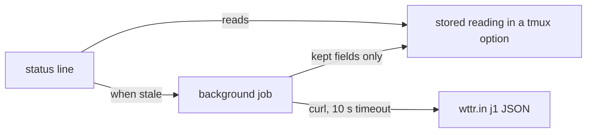

<div align="center">

# tmux-weather-revamped

<strong>Weather for the tmux status bar from wttr.in, fetched in the background so the status line never waits.</strong>

English &nbsp;|&nbsp; [日本語](README.ja.md) &nbsp;|&nbsp; [简体中文](README.zh-Hans.md) &nbsp;|&nbsp; [繁體中文（香港）](README.zh-HK.md)

[](https://github.com/tmux-revamped/tmux-weather-revamped/actions/workflows/tests.yml)
[](LICENSE)
[](CHANGELOG.md)

<p align="center">
  <a href="#what-it-does">What it does</a> &nbsp;|&nbsp;
  <a href="#requirements">Requirements</a> &nbsp;|&nbsp;
  <a href="#installation">Installation</a> &nbsp;|&nbsp;
  <a href="#usage">Usage</a> &nbsp;|&nbsp;
  <a href="#configuration">Configuration</a> &nbsp;|&nbsp;
  <a href="#key-bindings">Key bindings</a> &nbsp;|&nbsp;
  <a href="#how-it-works">How it works</a>
</p>

</div>

**28** status placeholders from **1** wttr.in request per location, every **15** minutes by default. A failed fetch keeps the last good reading on screen.

---

## What it does

The plugin fetches the wttr.in `j1` JSON for your location in a detached background job, keeps the fields it needs in a tmux option, and renders every placeholder from that stored copy. The status line reads the stored copy and returns at once, whether the network is up or not.

| Placeholder | Output |
|:------------|:-------|
| `#{weather}` | condition and temperature, such as `Partly cloudy +18°C` |
| `#{weather_temp}` | temperature without the leading plus, such as `18°C` |
| `#{weather_feels_like}` | feels-like temperature, such as `16` |
| `#{weather_wind}` | wind speed and direction, such as `11km/h NW` |
| `#{weather_humidity}` | relative humidity in percent |
| `#{weather_pressure}` | pressure in hPa |
| `#{weather_pressure_trend}` | `^`, `v` or `=` against the previous successful fetch |
| `#{weather_precip}` | precipitation in millimetres |
| `#{weather_rain_chance}` | the highest rain chance among today's first eight forecast slots |
| `#{weather_umbrella}` | your umbrella text once the rain chance reaches the threshold |
| `#{weather_uv}` | UV index |
| `#{weather_uv_color}` | a tmux style for the UV band |
| `#{weather_dew_point}` | mean dew point of today's first eight forecast slots |
| `#{weather_dew_comfort}` | `dry`, `comfortable`, `humid` or `oppressive` |
| `#{weather_moon}` | moon phase, such as `Waning Gibbous` |
| `#{weather_sunrise}` | sunrise, such as `06:00 AM` |
| `#{weather_sunset}` | sunset, such as `06:45 PM` |
| `#{weather_forecast}` | tomorrow's low and high, such as `15-27` |
| `#{weather_today_high}` | today's high |
| `#{weather_today_low}` | today's low |
| `#{weather_tomorrow_high}` | tomorrow's high |
| `#{weather_tomorrow_low}` | tomorrow's low |
| `#{weather_condition_icon}` | a Nerd Font Material Design glyph for the sky condition |
| `#{weather_condition_tint}` | a tmux style for the sky condition |
| `#{weather_color}` | a tmux style for the temperature band, such as `#[fg=green]` |
| `#{weather_icon}` | your icon for the temperature band, empty until set |
| `#{weather_stale_color}` | `#[dim]` once the last successful fetch is older than three intervals |
| `#{weather_alert}` | a severe-weather line, empty unless alerts are on |

## Requirements

| Tool | Version | Used for |
|:-----|:--------|:---------|
| tmux | 3.2 or later | the detail popup uses `display-popup` |
| bash | 3.2 or later | macOS `/bin/bash` works |
| `curl` | any | every fetch, with a 10 second timeout |
| network access to `wttr.in` | | the weather source |

CI runs the test suite on Ubuntu LTS for x86_64 and arm64 with GNU and uutils coreutils, and on macOS for Apple Silicon and Intel with the system tools, GNU tools and uutils.

## Installation

With [TPM](https://github.com/tmux-plugins/tpm), add the plugin and a placeholder to `~/.tmux.conf`, then press `prefix + I`:

```tmux
set -g @plugin 'tmux-revamped/tmux-weather-revamped'
set -g status-right '#{weather} '
```

Without TPM, clone the repository and run the entry point after your `status-right` is set:

```bash
git clone https://github.com/tmux-revamped/tmux-weather-revamped ~/.tmux/plugins/tmux-weather-revamped
```

```tmux
run-shell ~/.tmux/plugins/tmux-weather-revamped/weather-revamped.tmux
```

[`examples/status-right.tmux.conf`](examples/status-right.tmux.conf) holds a complete configuration.

## Usage

Set a location, or leave it empty to let wttr.in locate you by IP:

```tmux
set -g @tmux-weather-location 'Sao Paulo'
set -g status-right '#{weather_color}#{weather_condition_icon} #{weather_temp}#[default] '
```

The first render after a cold start is empty while the first fetch runs. A richer line uses more placeholders from the same reading, with no extra request:

```tmux
set -g status-right '#{weather_temp} #{weather_wind} #{weather_humidity}%% UV#{weather_uv} #{weather_forecast} '
```

### Temperature bands

`#{weather_color}` and `#{weather_icon}` read the option for the band the current temperature falls in. The bands use Celsius thresholds whatever the display units are.

| Band | Range in °C | Default color |
|:-----|:------------|:--------------|
| `freezing` | below 0 | `#[fg=blue]` |
| `cold` | 0 to 9 | `#[fg=cyan]` |
| `cool` | 10 to 17 | `#[fg=green]` |
| `comfortable` | 18 to 23 | `#[fg=green]` |
| `hot` | 24 to 31 | `#[fg=yellow]` |
| `very_hot` | 32 and up | `#[fg=red]` |

Each band reads `@weather_revamped_<band>_color` and `@weather_revamped_<band>_icon`. The icons default to empty, so no Nerd Font is needed until you set one.

### Sky conditions

The condition text maps to one of six keys, checked in this order, so a thundery shower is a storm and sleet is snow:

| Key | Condition contains | Default tint |
|:----|:-------------------|:-------------|
| `storm` | thunder, storm | `#[fg=magenta]` |
| `snow` | snow, sleet, blizzard, ice | `#[fg=white]` |
| `rain` | rain, drizzle, shower | `#[fg=blue]` |
| `fog` | fog, mist, haze | `#[fg=brightblack]` |
| `clouds` | cloud, overcast | `#[fg=brightblack]` |
| `clear` | anything else | `#[fg=yellow]` |

Set `@weather_revamped_<key>_condition_icon` to change a glyph and `@weather_revamped_<key>_tint` to change a tint. A tint option set to an empty string turns that tint off.

### Several locations

`@tmux-weather-locations` takes a `;`-separated list. Each location gets its own background fetch and its own stored reading. The `#{weather*}` placeholders show the first location. Call the script with a location name for the others:

```tmux
set -g @tmux-weather-locations 'London;Tokyo;New York'
set -g status-right '#{weather_temp} #(~/.tmux/plugins/tmux-weather-revamped/src/weather.sh temp Tokyo) '
```

### Severe-weather alerts

Alerts are off by default and use a second endpoint you choose. `{loc}` in the URL becomes the location. The first non-empty line of the response becomes `#{weather_alert}`, after `@weather_revamped_alert_prefix`.

```tmux
set -g @tmux-weather-alerts 'on'
set -g @tmux-weather-alert-url 'https://example.com/alerts/{loc}'
set -g @weather_revamped_alert_prefix '[!] '
```

### Render mode and fixed width

By default each placeholder becomes a `#()` call, which tmux reruns on every status redraw. Set `@weather_revamped_render` to `options` and each placeholder becomes an option read such as `#{E:@weather_revamped_out_temp}`. One background process per server renders every value the status line uses every `@weather_revamped_interval` seconds and writes them in one tmux call. The fetch keeps its own interval.

`@weather_revamped_fixed_width 'on'` pads `#{weather_temp}` on the left to five characters, so a change from `9°C` to `12°C` does not shift the rest of the line. `@weather_revamped_temp_width` sets the width directly.

```tmux
set -g @weather_revamped_render 'options'
set -g @weather_revamped_fixed_width 'on'
```

### Doctor

```bash
~/.tmux/plugins/tmux-weather-revamped/src/weather.sh doctor
```

It prints whether `curl` is on `PATH`, the units, the interval, whether alerts are on, the locations, and the age, temperature and condition of the stored reading.

## Configuration

| Option | Default | Meaning |
|:-------|:--------|:--------|
| `@tmux-weather-location` | empty | city or place. Empty lets wttr.in locate you by IP |
| `@tmux-weather-locations` | empty | `;`-separated list. Overrides the single location |
| `@tmux-weather-units` | `m` | metric. `u`, `f` or `fahrenheit` switch temperatures to Fahrenheit and wind to mph |
| `@tmux-weather-interval` | `15` | minutes between fetches |
| `@tmux-weather-hide-units` | `off` | `on` drops the `C` or `F` from `#{weather_temp}` |
| `@tmux-weather-alerts` | `off` | `on` fetches the alert endpoint |
| `@tmux-weather-alert-url` | empty | alert endpoint, with `{loc}` replaced by the location |
| `@tmux-weather-popup-key` | `M-w` | prefix key for the detail popup. `off` binds nothing |
| `@tmux-weather-refresh-key` | empty | prefix key that fetches now |
| `@weather_revamped_show_condition_icon` | `on` | `off` empties `#{weather_condition_icon}` |
| `@weather_revamped_<key>_condition_icon` | Material Design glyph | glyph for one sky condition key |
| `@weather_revamped_<key>_tint` | per key, above | style for one sky condition key |
| `@weather_revamped_<band>_color` | per band, above | style for one temperature band |
| `@weather_revamped_<band>_icon` | empty | icon for one temperature band |
| `@weather_revamped_umbrella_text` | empty | text for `#{weather_umbrella}`. `{chance}` becomes the rain chance |
| `@weather_revamped_umbrella_threshold` | `50` | rain chance in percent at which the umbrella text shows |
| `@weather_revamped_alert_prefix` | empty | text before `#{weather_alert}` |
| `@weather_revamped_stale_color` | `#[dim]` | style `#{weather_stale_color}` emits once the reading is stale |
| `@weather_revamped_pressure_delta` | `1` | hPa change beyond which the trend is rising or falling |
| `@weather_revamped_pressure_rising` | `^` | rising mark |
| `@weather_revamped_pressure_falling` | `v` | falling mark |
| `@weather_revamped_pressure_steady` | `=` | steady mark |
| `@weather_revamped_uv_low_color` | `#[fg=green]` | UV 0 to 2 |
| `@weather_revamped_uv_moderate_color` | `#[fg=yellow]` | UV 3 to 5 |
| `@weather_revamped_uv_high_color` | `#[fg=colour208]` | UV 6 to 7 |
| `@weather_revamped_uv_very_high_color` | `#[fg=red]` | UV 8 to 10 |
| `@weather_revamped_uv_extreme_color` | `#[fg=magenta]` | UV 11 and up |
| `@weather_revamped_render` | empty | `options` turns on render mode |
| `@weather_revamped_interval` | `60` | seconds between render-mode ticks |
| `@weather_revamped_fixed_width` | `off` | `on` pads the temperature to five characters |
| `@weather_revamped_temp_width` | empty | explicit width for the temperature |

The colors are the 16 ANSI names, so they follow your terminal theme. To pin exact shades, set the band options to hex values.

<details>
<summary><strong>Hex colors for six themes</strong></summary>

```tmux
# Catppuccin Mocha
set -g @weather_revamped_freezing_color '#[fg=#89b4fa]'
set -g @weather_revamped_cold_color '#[fg=#94e2d5]'
set -g @weather_revamped_cool_color '#[fg=#a6e3a1]'
set -g @weather_revamped_comfortable_color '#[fg=#a6e3a1]'
set -g @weather_revamped_hot_color '#[fg=#f9e2af]'
set -g @weather_revamped_very_hot_color '#[fg=#f38ba8]'

# Dracula
set -g @weather_revamped_freezing_color '#[fg=#bd93f9]'
set -g @weather_revamped_cold_color '#[fg=#8be9fd]'
set -g @weather_revamped_cool_color '#[fg=#50fa7b]'
set -g @weather_revamped_comfortable_color '#[fg=#50fa7b]'
set -g @weather_revamped_hot_color '#[fg=#f1fa8c]'
set -g @weather_revamped_very_hot_color '#[fg=#ff5555]'

# Nord
set -g @weather_revamped_freezing_color '#[fg=#81a1c1]'
set -g @weather_revamped_cold_color '#[fg=#88c0d0]'
set -g @weather_revamped_cool_color '#[fg=#a3be8c]'
set -g @weather_revamped_comfortable_color '#[fg=#a3be8c]'
set -g @weather_revamped_hot_color '#[fg=#ebcb8b]'
set -g @weather_revamped_very_hot_color '#[fg=#bf616a]'

# Gruvbox Dark
set -g @weather_revamped_freezing_color '#[fg=#83a598]'
set -g @weather_revamped_cold_color '#[fg=#8ec07c]'
set -g @weather_revamped_cool_color '#[fg=#b8bb26]'
set -g @weather_revamped_comfortable_color '#[fg=#b8bb26]'
set -g @weather_revamped_hot_color '#[fg=#fabd2f]'
set -g @weather_revamped_very_hot_color '#[fg=#fb4934]'

# Tokyo Night
set -g @weather_revamped_freezing_color '#[fg=#7aa2f7]'
set -g @weather_revamped_cold_color '#[fg=#7dcfff]'
set -g @weather_revamped_cool_color '#[fg=#9ece6a]'
set -g @weather_revamped_comfortable_color '#[fg=#9ece6a]'
set -g @weather_revamped_hot_color '#[fg=#e0af68]'
set -g @weather_revamped_very_hot_color '#[fg=#f7768e]'

# Solarized Dark
set -g @weather_revamped_freezing_color '#[fg=#268bd2]'
set -g @weather_revamped_cold_color '#[fg=#2aa198]'
set -g @weather_revamped_cool_color '#[fg=#859900]'
set -g @weather_revamped_comfortable_color '#[fg=#859900]'
set -g @weather_revamped_hot_color '#[fg=#b58900]'
set -g @weather_revamped_very_hot_color '#[fg=#dc322f]'
```

</details>

### Internal state

The plugin manages these options itself. Do not set them.

| Option | Holds |
|:-------|:------|
| `@weather_revamped_value_<location>` | the stored reading for one location, with `_ts` and `_lock` companions for its age and the running fetch |
| `@weather_revamped_alert_<location>` | the stored alert line for one location |
| `@weather_revamped_<location>_ok_ts` | the time of the last successful fetch, read by `#{weather_stale_color}` |
| `@weather_revamped_<location>_pressure_prev` | the pressure from the previous successful fetch, read by the trend |
| `@weather_revamped_published` | the placeholders the status line uses, recorded at load so render mode publishes only those |
| `@weather_revamped_out_<name>` | each rendered value in render mode |
| `@weather_revamped_ticker_pid` | the process that owns render mode |
| `@weather_revamped_option_names` | the options render mode reads in one tmux call per tick |

`<location>` is the location name with every character outside `A-Z`, `a-z`, `0-9` and `_` replaced by `_`, or `auto` for an empty location.

## Key bindings

| Key | Option | Action |
|:----|:-------|:-------|
| `prefix + M-w` | `@tmux-weather-popup-key` | open a card built from the stored reading for the first location |
| unbound | `@tmux-weather-refresh-key` | fetch the first location now |

The card shows the condition, temperature and feels-like, wind, humidity, pressure, UV, dew point with its comfort word, precipitation and rain chance, sunrise, sunset, the moon phase, and today's and tomorrow's ranges. It reads the stored copy and makes no request.

## How it works



At load, [`weather-revamped.tmux`](weather-revamped.tmux) replaces each placeholder in the status line with a call to [`src/weather.sh`](src/weather.sh), or with an option read in render mode, and binds the keys. Each render checks the age of the stored reading. When it is older than `@tmux-weather-interval`, a detached subshell takes a lock and fetches, and the render returns the stored copy without waiting. The lock expires after 20 seconds, so a fetch that dies does not block the next one.

A response containing `Unknown location`, `ERROR` or `Sorry` is discarded and the previous reading stays. A successful response is cut down to the 22 JSON fields the plugin reads, which keeps the stored copy at about 9 KB instead of the 40 KB or so that wttr.in sends. Every `#` in the condition text and the alert line is doubled before it reaches the status line, so a response cannot run a tmux format.

## Development

| Command | What it runs |
|:--------|:-------------|
| `make test` | the bats suite |
| `make lint` | shellcheck at warning level on every shell file |
| `make coverage` | kcov line coverage with a 95 percent floor, Linux only |
| [`family/bin/audit`](family/bin/audit) | this repository against the family contract |

## License

[MIT](LICENSE), copyright Gustavo Franco. Weather data comes from [wttr.in](https://github.com/chubin/wttr.in). Inspired by [tmux-weather](https://github.com/ilya-manin/tmux-weather).

<!-- family:begin -->

## The tmux-revamped family

This plugin is one member of the tmux-revamped family. Every member carries the
same contract in [`FAMILY.md`](FAMILY.md), the same tooling under `family/`, and
the same shared library, all held byte-identical by a checksum manifest. They are
built to be installed together: no member claims a key or a tmux option that
another member claims.

A defect found in one member is hunted across all of them before the fix is
called done. That obligation is written into the contract rather than left to
memory, and `family/bin/sweep` is how it is discharged.

| Member | What it does |
|---|---|
| [`tmux-autoreload-revamped`](https://github.com/tmux-revamped/tmux-autoreload-revamped) | Edit your tmux config, save, and watch it reload itself, no key, no command |
| [`tmux-battery-revamped`](https://github.com/tmux-revamped/tmux-battery-revamped) | Battery status for your tmux status bar, without ever blocking the status render |
| [`tmux-bluetooth-revamped`](https://github.com/tmux-revamped/tmux-bluetooth-revamped) | Every connected Bluetooth device and its battery in your tmux status bar, without blocking the render |
| [`tmux-cpu-revamped`](https://github.com/tmux-revamped/tmux-cpu-revamped) | CPU load, temperature, and frequency in your tmux status bar, without ever blocking the render |
| [`tmux-disk-revamped`](https://github.com/tmux-revamped/tmux-disk-revamped) | Disk usage for your tmux status bar, without ever blocking the status render |
| [`tmux-extract-revamped`](https://github.com/tmux-revamped/tmux-extract-revamped) | Pick a URL, path, hash or any other token off the screen with fzf and type it at the cursor, in pure shell |
| [`tmux-fzf-revamped`](https://github.com/tmux-revamped/tmux-fzf-revamped) | Switch to, kill, rename or create tmux sessions, windows and panes from fzf pickers in a popup |
| [`tmux-git-revamped`](https://github.com/tmux-revamped/tmux-git-revamped) | Show the active pane's git branch, changes and provider counts in the tmux status bar without blocking it |
| [`tmux-gpu-revamped`](https://github.com/tmux-revamped/tmux-gpu-revamped) | GPU load, temperature, clock, power and memory in the tmux status bar, from NVIDIA, AMD, Intel and Apple GPUs |
| [`tmux-kube-revamped`](https://github.com/tmux-revamped/tmux-kube-revamped) | Current Kubernetes context and namespace in the tmux status bar, parsed from kubeconfig without kubectl |
| [`tmux-launcher-revamped`](https://github.com/tmux-revamped/tmux-launcher-revamped) | Launch any TUI app in a popup or a window, scoped to the current pane's directory, with one configurable bindi |
| [`tmux-logging-revamped`](https://github.com/tmux-revamped/tmux-logging-revamped) | Capture any pane to a file: live logging, full scrollback, or a one-shot screenshot |
| [`tmux-music-revamped`](https://github.com/tmux-revamped/tmux-music-revamped) | Now playing in your tmux status bar, without ever blocking the status render |
| [`tmux-network-revamped`](https://github.com/tmux-revamped/tmux-network-revamped) | Network throughput in your tmux status bar, without ever blocking the render |
| [`tmux-pain-control-revamped`](https://github.com/tmux-revamped/tmux-pain-control-revamped) | Pane and window management bindings for tmux, version aware, vim friendly, every prefix key can be disabled |
| [`tmux-persist-revamped`](https://github.com/tmux-revamped/tmux-persist-revamped) | Save every tmux session, window and pane, auto-save on a timer, and restore it all after a reboot |
| [`tmux-plugin-template`](https://github.com/tmux-revamped/tmux-plugin-template) | The starting point for a tmux-revamped plugin: shared library, bats harness, CI and family tooling |
| [`tmux-pomodoro-revamped`](https://github.com/tmux-revamped/tmux-pomodoro-revamped) | A Pomodoro timer in the tmux status bar that keeps all of its state in tmux options, with no temp files |
| [`tmux-ram-revamped`](https://github.com/tmux-revamped/tmux-ram-revamped) | RAM, swap and memory pressure in the tmux status bar, sampled in the background so the render never waits |
| [`tmux-reorder-revamped`](https://github.com/tmux-revamped/tmux-reorder-revamped) | Drag a window tab along the tmux status bar with the mouse to move that window |
| [`tmux-scroll-revamped`](https://github.com/tmux-revamped/tmux-scroll-revamped) | Send the mouse wheel to apps that scroll themselves and into tmux copy-mode everywhere else |
| [`tmux-sensible-revamped`](https://github.com/tmux-revamped/tmux-sensible-revamped) | Sensible tmux defaults, gated by tmux version and terminal, that leave the options you set alone |
| [`tmux-tiling-revamped`](https://github.com/tmux-revamped/tmux-tiling-revamped) | Tiling window management for tmux: eight layouts including BSP dwindle and spiral, with layout undo |
| [`tmux-time-revamped`](https://github.com/tmux-revamped/tmux-time-revamped) | Local and world clocks for the tmux status bar, colored by time of day, with countdowns and a DST warning |
| [`tmux-weather-revamped`](https://github.com/tmux-revamped/tmux-weather-revamped) | **this plugin**, Weather for the tmux status bar from wttr.in, fetched in the background so the status line never waits |

### Checking an installation

With every member on disk, one command reports any conflict between them:

```sh
family/bin/doctor --live
```

It reads each member and the running tmux server, and reports duplicate keys,
duplicate status placeholders, options outside the naming grammar, and any
member whose contract version has fallen behind.

<!-- family:end -->
