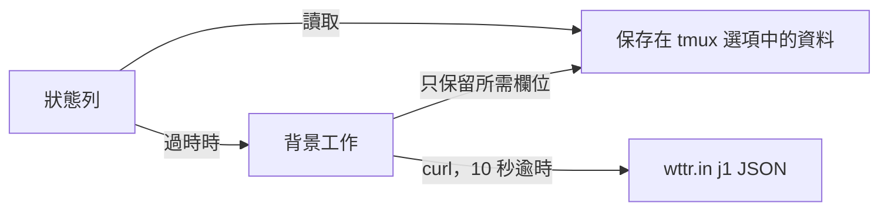

<div align="center">

# tmux-weather-revamped

<strong>在背景從 wttr.in 取得天氣並顯示在狀態列，狀態列毋須等待。</strong>

[English](README.md) &nbsp;|&nbsp; [日本語](README.ja.md) &nbsp;|&nbsp; [简体中文](README.zh-Hans.md) &nbsp;|&nbsp; 繁體中文（香港）

[](https://github.com/tmux-revamped/tmux-weather-revamped/actions/workflows/tests.yml)
[](LICENSE)
[](CHANGELOG.md)

<p align="center">
  <a href="#功能">功能</a> &nbsp;|&nbsp;
  <a href="#系統要求">系統要求</a> &nbsp;|&nbsp;
  <a href="#安裝">安裝</a> &nbsp;|&nbsp;
  <a href="#用法">用法</a> &nbsp;|&nbsp;
  <a href="#設定">設定</a> &nbsp;|&nbsp;
  <a href="#快捷鍵">快捷鍵</a> &nbsp;|&nbsp;
  <a href="#運作原理">運作原理</a>
</p>

</div>

**28** 個狀態佔位符，每個地點只需 **1** 次 wttr.in 請求，預設每 **15** 分鐘一次。取得失敗時，螢幕上保留最後一次成功的資料。

---

## 功能

本插件在分離的背景工作中取得你所在地點的 wttr.in `j1` JSON，把需要的欄位存放在一個 tmux 選項中，並從這份保存的副本繪製所有佔位符。狀態列只讀取保存的副本，因此無論網絡是否可用都會即時返回。

| 佔位符 | 輸出 |
|:------------|:-------|
| `#{weather}` | 天氣狀況和溫度，例如 `Partly cloudy +18°C` |
| `#{weather_temp}` | 去掉前置加號的溫度，例如 `18°C` |
| `#{weather_feels_like}` | 體感溫度，例如 `16` |
| `#{weather_wind}` | 風速和風向，例如 `11km/h NW` |
| `#{weather_humidity}` | 相對濕度，百分比 |
| `#{weather_pressure}` | 氣壓，單位 hPa |
| `#{weather_pressure_trend}` | 與上一次成功取得相比的 `^`、`v` 或 `=` |
| `#{weather_precip}` | 降雨量，單位毫米 |
| `#{weather_rain_chance}` | 今天首八個預報時段中最高的降雨概率 |
| `#{weather_umbrella}` | 降雨概率達到門檻時顯示的雨傘文字 |
| `#{weather_uv}` | 紫外線指數 |
| `#{weather_uv_color}` | 對應紫外線級別的 tmux 樣式 |
| `#{weather_dew_point}` | 今天首八個預報時段的平均露點 |
| `#{weather_dew_comfort}` | `dry`、`comfortable`、`humid` 或 `oppressive` |
| `#{weather_moon}` | 月相，例如 `Waning Gibbous` |
| `#{weather_sunrise}` | 日出時間，例如 `06:00 AM` |
| `#{weather_sunset}` | 日落時間，例如 `06:45 PM` |
| `#{weather_forecast}` | 明天的最低和最高溫度，例如 `15-27` |
| `#{weather_today_high}` | 今天的最高溫度 |
| `#{weather_today_low}` | 今天的最低溫度 |
| `#{weather_tomorrow_high}` | 明天的最高溫度 |
| `#{weather_tomorrow_low}` | 明天的最低溫度 |
| `#{weather_condition_icon}` | 表示天氣狀況的 Nerd Font Material Design 圖示 |
| `#{weather_condition_tint}` | 對應天氣狀況的 tmux 樣式 |
| `#{weather_color}` | 對應溫度區間的 tmux 樣式，例如 `#[fg=green]` |
| `#{weather_icon}` | 溫度區間的圖示，設定之前為空 |
| `#{weather_stale_color}` | 最後一次成功取得超過三個間隔時為 `#[dim]` |
| `#{weather_alert}` | 一行惡劣天氣資訊，未開啟警告時為空 |

## 系統要求

| 工具 | 版本 | 用途 |
|:-----|:--------|:---------|
| tmux | 3.2 或以上 | 詳情彈出視窗使用 `display-popup` |
| bash | 3.2 或以上 | 可使用 macOS 的 `/bin/bash` |
| `curl` | 任何 | 每次取得，10 秒逾時 |
| 可連接 `wttr.in` 的網絡 | | 天氣資料來源 |

CI 在 Ubuntu LTS 的 x86_64 和 arm64 上使用 GNU 和 uutils coreutils 執行測試，在 macOS 的 Apple Silicon 和 Intel 上使用系統工具、GNU 工具和 uutils 執行測試。

## 安裝

使用 [TPM](https://github.com/tmux-plugins/tpm) 時，把插件和一個佔位符加入 `~/.tmux.conf`，然後按 `prefix + I`：

```tmux
set -g @plugin 'tmux-revamped/tmux-weather-revamped'
set -g status-right '#{weather} '
```

不使用 TPM 時，複製儲存庫，並在設定 `status-right` 之後執行入口腳本：

```bash
git clone https://github.com/tmux-revamped/tmux-weather-revamped ~/.tmux/plugins/tmux-weather-revamped
```

```tmux
run-shell ~/.tmux/plugins/tmux-weather-revamped/weather-revamped.tmux
```

完整的設定範例見 [`examples/status-right.tmux.conf`](examples/status-right.tmux.conf)。

## 用法

設定一個地點，或留空讓 wttr.in 按 IP 定位：

```tmux
set -g @tmux-weather-location 'Sao Paulo'
set -g status-right '#{weather_color}#{weather_condition_icon} #{weather_temp}#[default] '
```

冷啟動後的第一次繪製為空，直至第一次取得完成。使用同一份資料中的更多佔位符，可以得到更豐富的一行而不增加請求：

```tmux
set -g status-right '#{weather_temp} #{weather_wind} #{weather_humidity}%% UV#{weather_uv} #{weather_forecast} '
```

### 溫度區間

`#{weather_color}` 和 `#{weather_icon}` 讀取目前溫度所在區間的選項。無論顯示單位是甚麼，區間都使用攝氏門檻。

| 區間 | 範圍，°C | 預設顏色 |
|:-----|:------------|:--------------|
| `freezing` | 低於 0 | `#[fg=blue]` |
| `cold` | 0 至 9 | `#[fg=cyan]` |
| `cool` | 10 至 17 | `#[fg=green]` |
| `comfortable` | 18 至 23 | `#[fg=green]` |
| `hot` | 24 至 31 | `#[fg=yellow]` |
| `very_hot` | 32 或以上 | `#[fg=red]` |

每個區間讀取 `@weather_revamped_<band>_color` 和 `@weather_revamped_<band>_icon`。圖示預設為空，所以在設定之前毋須 Nerd Font。

### 天氣狀況

天氣狀況文字對應六個鍵之一，按以下次序檢查，因此雷暴驟雨屬於 storm，雨夾雪屬於 snow：

| 鍵 | 天氣文字包含 | 預設色調 |
|:----|:-------------------|:-------------|
| `storm` | thunder、storm | `#[fg=magenta]` |
| `snow` | snow、sleet、blizzard、ice | `#[fg=white]` |
| `rain` | rain、drizzle、shower | `#[fg=blue]` |
| `fog` | fog、mist、haze | `#[fg=brightblack]` |
| `clouds` | cloud、overcast | `#[fg=brightblack]` |
| `clear` | 其他任何內容 | `#[fg=yellow]` |

設定 `@weather_revamped_<key>_condition_icon` 可更換圖示，設定 `@weather_revamped_<key>_tint` 可更換色調。把色調選項設為空字串便可關閉該色調。

### 多個地點

`@tmux-weather-locations` 接受以 `;` 分隔的清單。每個地點都有自己的背景取得和自己保存的資料。`#{weather*}` 佔位符顯示第一個地點。其他地點需附上地點名稱呼叫腳本：

```tmux
set -g @tmux-weather-locations 'London;Tokyo;New York'
set -g status-right '#{weather_temp} #(~/.tmux/plugins/tmux-weather-revamped/src/weather.sh temp Tokyo) '
```

### 惡劣天氣警告

警告預設關閉，並使用你選擇的第二個端點。URL 中的 `{loc}` 會取代為地點。回應中第一個非空行會接在 `@weather_revamped_alert_prefix` 之後，成為 `#{weather_alert}`。

```tmux
set -g @tmux-weather-alerts 'on'
set -g @tmux-weather-alert-url 'https://example.com/alerts/{loc}'
set -g @weather_revamped_alert_prefix '[!] '
```

### 渲染模式與固定寬度

預設情況下每個佔位符都變成一個 `#()` 呼叫，tmux 每次重繪狀態列都會重新執行它。把 `@weather_revamped_render` 設為 `options` 後，每個佔位符變成對選項的讀取，例如 `#{E:@weather_revamped_out_temp}`。每部伺服器上的一個背景進程每隔 `@weather_revamped_interval` 秒繪製狀態列用到的所有值，並以一次 tmux 呼叫寫入。取得仍按其自己的間隔進行。

`@weather_revamped_fixed_width 'on'` 會在 `#{weather_temp}` 左方補齊至五個字符，因此由 `9°C` 變為 `12°C` 時，這一行的其餘部分不會移動。`@weather_revamped_temp_width` 可直接設定寬度。

```tmux
set -g @weather_revamped_render 'options'
set -g @weather_revamped_fixed_width 'on'
```

### 診斷

```bash
~/.tmux/plugins/tmux-weather-revamped/src/weather.sh doctor
```

它會列印 `curl` 是否在 `PATH` 中、單位、間隔、是否開啟警告、各個地點，以及保存資料的時長、溫度和天氣狀況。

## 設定

| 選項 | 預設值 | 意思 |
|:-------|:--------|:--------|
| `@tmux-weather-location` | 空 | 城市或地點。為空時由 wttr.in 按 IP 定位 |
| `@tmux-weather-locations` | 空 | 以 `;` 分隔的清單，優先於單一地點 |
| `@tmux-weather-units` | `m` | 公制。`u`、`f` 或 `fahrenheit` 把溫度切換為華氏、風速切換為 mph |
| `@tmux-weather-interval` | `15` | 取得的間隔，以分鐘計 |
| `@tmux-weather-hide-units` | `off` | 設為 `on` 時從 `#{weather_temp}` 中去掉 `C` 或 `F` |
| `@tmux-weather-alerts` | `off` | 設為 `on` 時取得警告端點 |
| `@tmux-weather-alert-url` | 空 | 警告端點，`{loc}` 會取代為地點 |
| `@tmux-weather-popup-key` | `M-w` | 詳情彈出視窗的前綴鍵。`off` 表示不綁定 |
| `@tmux-weather-refresh-key` | 空 | 即時取得的前綴鍵 |
| `@weather_revamped_show_condition_icon` | `on` | 設為 `off` 時 `#{weather_condition_icon}` 為空 |
| `@weather_revamped_<key>_condition_icon` | Material Design 圖示 | 某個天氣狀況鍵的圖示 |
| `@weather_revamped_<key>_tint` | 按鍵區分，見上文 | 某個天氣狀況鍵的樣式 |
| `@weather_revamped_<band>_color` | 按區間區分，見上文 | 某個溫度區間的樣式 |
| `@weather_revamped_<band>_icon` | 空 | 某個溫度區間的圖示 |
| `@weather_revamped_umbrella_text` | 空 | `#{weather_umbrella}` 的文字。`{chance}` 會取代為降雨概率 |
| `@weather_revamped_umbrella_threshold` | `50` | 顯示雨傘文字的降雨概率，百分比 |
| `@weather_revamped_alert_prefix` | 空 | `#{weather_alert}` 前的文字 |
| `@weather_revamped_stale_color` | `#[dim]` | 資料過時時 `#{weather_stale_color}` 輸出的樣式 |
| `@weather_revamped_pressure_delta` | `1` | 視為上升或下降的氣壓變化，單位 hPa |
| `@weather_revamped_pressure_rising` | `^` | 上升標記 |
| `@weather_revamped_pressure_falling` | `v` | 下降標記 |
| `@weather_revamped_pressure_steady` | `=` | 平穩標記 |
| `@weather_revamped_uv_low_color` | `#[fg=green]` | 紫外線 0 至 2 |
| `@weather_revamped_uv_moderate_color` | `#[fg=yellow]` | 紫外線 3 至 5 |
| `@weather_revamped_uv_high_color` | `#[fg=colour208]` | 紫外線 6 至 7 |
| `@weather_revamped_uv_very_high_color` | `#[fg=red]` | 紫外線 8 至 10 |
| `@weather_revamped_uv_extreme_color` | `#[fg=magenta]` | 紫外線 11 或以上 |
| `@weather_revamped_render` | 空 | 設為 `options` 開啟渲染模式 |
| `@weather_revamped_interval` | `60` | 渲染模式每次執行的間隔，以秒計 |
| `@weather_revamped_fixed_width` | `off` | 設為 `on` 時把溫度補齊至五個字符 |
| `@weather_revamped_temp_width` | 空 | 溫度的明確寬度 |

顏色使用 16 種 ANSI 名稱，因此會跟隨終端機主題。如要固定確切色調，把區間選項設為十六進制值。

<details>
<summary><strong>六個主題的十六進制顏色</strong></summary>

```tmux
# Catppuccin Mocha
set -g @weather_revamped_freezing_color '#[fg=#89b4fa]'
set -g @weather_revamped_cold_color '#[fg=#94e2d5]'
set -g @weather_revamped_cool_color '#[fg=#a6e3a1]'
set -g @weather_revamped_comfortable_color '#[fg=#a6e3a1]'
set -g @weather_revamped_hot_color '#[fg=#f9e2af]'
set -g @weather_revamped_very_hot_color '#[fg=#f38ba8]'

# Dracula
set -g @weather_revamped_freezing_color '#[fg=#bd93f9]'
set -g @weather_revamped_cold_color '#[fg=#8be9fd]'
set -g @weather_revamped_cool_color '#[fg=#50fa7b]'
set -g @weather_revamped_comfortable_color '#[fg=#50fa7b]'
set -g @weather_revamped_hot_color '#[fg=#f1fa8c]'
set -g @weather_revamped_very_hot_color '#[fg=#ff5555]'

# Nord
set -g @weather_revamped_freezing_color '#[fg=#81a1c1]'
set -g @weather_revamped_cold_color '#[fg=#88c0d0]'
set -g @weather_revamped_cool_color '#[fg=#a3be8c]'
set -g @weather_revamped_comfortable_color '#[fg=#a3be8c]'
set -g @weather_revamped_hot_color '#[fg=#ebcb8b]'
set -g @weather_revamped_very_hot_color '#[fg=#bf616a]'

# Gruvbox Dark
set -g @weather_revamped_freezing_color '#[fg=#83a598]'
set -g @weather_revamped_cold_color '#[fg=#8ec07c]'
set -g @weather_revamped_cool_color '#[fg=#b8bb26]'
set -g @weather_revamped_comfortable_color '#[fg=#b8bb26]'
set -g @weather_revamped_hot_color '#[fg=#fabd2f]'
set -g @weather_revamped_very_hot_color '#[fg=#fb4934]'

# Tokyo Night
set -g @weather_revamped_freezing_color '#[fg=#7aa2f7]'
set -g @weather_revamped_cold_color '#[fg=#7dcfff]'
set -g @weather_revamped_cool_color '#[fg=#9ece6a]'
set -g @weather_revamped_comfortable_color '#[fg=#9ece6a]'
set -g @weather_revamped_hot_color '#[fg=#e0af68]'
set -g @weather_revamped_very_hot_color '#[fg=#f7768e]'

# Solarized Dark
set -g @weather_revamped_freezing_color '#[fg=#268bd2]'
set -g @weather_revamped_cold_color '#[fg=#2aa198]'
set -g @weather_revamped_cool_color '#[fg=#859900]'
set -g @weather_revamped_comfortable_color '#[fg=#859900]'
set -g @weather_revamped_hot_color '#[fg=#b58900]'
set -g @weather_revamped_very_hot_color '#[fg=#dc322f]'
```

</details>

### 內部狀態

這些選項由插件自行管理，請勿設定。

| 選項 | 保存內容 |
|:-------|:------|
| `@weather_revamped_value_<location>` | 一個地點保存的資料，並附有表示其時效和進行中取得的 `_ts` 與 `_lock` |
| `@weather_revamped_alert_<location>` | 一個地點保存的警告行 |
| `@weather_revamped_<location>_ok_ts` | 最後一次成功取得的時間，由 `#{weather_stale_color}` 讀取 |
| `@weather_revamped_<location>_pressure_prev` | 上一次成功取得的氣壓，由趨勢判斷讀取 |
| `@weather_revamped_published` | 狀態列用到的佔位符，在載入時記錄，令渲染模式只發佈這些 |
| `@weather_revamped_out_<name>` | 渲染模式下繪製出的每個值 |
| `@weather_revamped_ticker_pid` | 負責渲染模式的進程 |
| `@weather_revamped_option_names` | 渲染模式每次執行時以一次 tmux 呼叫讀取的選項 |

`<location>` 是把地點名稱中 `A-Z`、`a-z`、`0-9` 和 `_` 以外的字符都取代為 `_` 的結果，地點為空時為 `auto`。

## 快捷鍵

| 按鍵 | 選項 | 動作 |
|:----|:-------|:-------|
| `prefix + M-w` | `@tmux-weather-popup-key` | 開啟根據第一個地點的保存資料製作的卡片 |
| 不綁定 | `@tmux-weather-refresh-key` | 即時取得第一個地點 |

卡片顯示天氣狀況、溫度和體感溫度、風、濕度、氣壓、紫外線、露點及其舒適度、降雨量和降雨概率、日出、日落、月相，以及今天和明天的溫度範圍。它只讀取保存的副本，不會發出請求。

## 運作原理



載入時，[`weather-revamped.tmux`](weather-revamped.tmux) 把狀態列中的每個佔位符取代為對 [`src/weather.sh`](src/weather.sh) 的呼叫，或在渲染模式下取代為對選項的讀取，並綁定按鍵。每次繪製都會檢查保存資料的時長。超過 `@tmux-weather-interval` 時，一個分離的子 shell 取得鎖並開始取得，繪製則不等待，直接返回保存的副本。鎖在 20 秒後過期，因此中途終止的取得不會阻塞下一次取得。

含有 `Unknown location`、`ERROR` 或 `Sorry` 的回應會被捨棄，保留之前的資料。成功的回應會精簡為插件讀取的 22 個 JSON 欄位，令保存的副本約為 9 KB，而不是 wttr.in 傳送的約 40 KB。天氣狀況文字和警告行中的每個 `#` 在到達狀態列之前都會加倍，因此回應無法作為 tmux 格式執行。

## 開發

| 指令 | 執行內容 |
|:--------|:-------------|
| `make test` | bats 測試套件 |
| `make lint` | 對所有 shell 檔案執行 warning 級別的 shellcheck |
| `make coverage` | kcov 行覆蓋率，下限 95%，只限 Linux |
| [`family/bin/audit`](family/bin/audit) | 按系列約定檢查本儲存庫 |

## 授權

[MIT](LICENSE)，copyright Gustavo Franco。天氣資料來自 [wttr.in](https://github.com/chubin/wttr.in)。靈感來自 [tmux-weather](https://github.com/ilya-manin/tmux-weather)。

<!-- family:begin -->

## tmux-revamped 插件家族

本插件是 tmux-revamped 插件家族的成員。每個成員都帶有 [`FAMILY.md`](FAMILY.md) 中的同一份約定、`family/` 下的同一套工具和同一個共用程式庫，並由校驗和清單確保逐位元組一致。這些成員可以一併安裝：任何成員都不會佔用其他成員使用的按鍵或 tmux 選項。

在一個成員中發現的缺陷，要在全部成員中排查後才算修正完成。這項責任寫在約定之中，而不是依靠記憶，`family/bin/sweep` 負責執行。

| 成員 | 功能 |
|---|---|
| [`tmux-autoreload-revamped`](https://github.com/tmux-revamped/tmux-autoreload-revamped) | 編輯並儲存 tmux 設定後，它會自動重新載入，毋須按鍵，也毋須指令 |
| [`tmux-battery-revamped`](https://github.com/tmux-revamped/tmux-battery-revamped) | 在 tmux 狀態列顯示電池狀態，從不阻塞狀態列繪製 |
| [`tmux-bluetooth-revamped`](https://github.com/tmux-revamped/tmux-bluetooth-revamped) | 在 tmux 狀態列顯示每部已連接的藍牙裝置及其電量，不阻塞繪製 |
| [`tmux-cpu-revamped`](https://github.com/tmux-revamped/tmux-cpu-revamped) | 在 tmux 狀態列顯示 CPU 負載、溫度及頻率，從不阻塞繪製 |
| [`tmux-disk-revamped`](https://github.com/tmux-revamped/tmux-disk-revamped) | 在 tmux 狀態列顯示磁碟用量，從不阻塞狀態列繪製 |
| [`tmux-extract-revamped`](https://github.com/tmux-revamped/tmux-extract-revamped) | 用 fzf 從畫面上揀選 URL、路徑、雜湊值或任何其他字詞，並輸入到游標位置，全部以純 shell 實現 |
| [`tmux-fzf-revamped`](https://github.com/tmux-revamped/tmux-fzf-revamped) | 在彈出視窗的 fzf 選擇器中切換、關閉、重新命名或建立 tmux 工作階段、視窗和窗格 |
| [`tmux-git-revamped`](https://github.com/tmux-revamped/tmux-git-revamped) | 在 tmux 狀態列顯示當前窗格的 git 分支、改動和託管平台數目，而不會阻塞顯示 |
| [`tmux-gpu-revamped`](https://github.com/tmux-revamped/tmux-gpu-revamped) | 在 tmux 狀態列顯示 NVIDIA、AMD、Intel 及 Apple GPU 的負載、溫度、時脈、功耗及記憶體 |
| [`tmux-kube-revamped`](https://github.com/tmux-revamped/tmux-kube-revamped) | 在 tmux 狀態列顯示目前的 Kubernetes 上下文及命名空間，毋須 kubectl，直接解析 kubeconfig |
| [`tmux-launcher-revamped`](https://github.com/tmux-revamped/tmux-launcher-revamped) | 在彈出視窗或新視窗中啟動任何 TUI 應用程式，從目前窗格的目錄開始，每個應用程式可設定一個按鍵 |
| [`tmux-logging-revamped`](https://github.com/tmux-revamped/tmux-logging-revamped) | 將任何窗格儲存到檔案：即時記錄、完整捲動緩衝區或一次性截圖 |
| [`tmux-music-revamped`](https://github.com/tmux-revamped/tmux-music-revamped) | 在 tmux 狀態列顯示正在播放的歌曲，從不阻塞狀態列的繪製 |
| [`tmux-network-revamped`](https://github.com/tmux-revamped/tmux-network-revamped) | 在 tmux 狀態列顯示網絡傳輸量，從不阻塞繪製 |
| [`tmux-pain-control-revamped`](https://github.com/tmux-revamped/tmux-pain-control-revamped) | tmux 的窗格和視窗管理按鍵，配合 tmux 版本，與 vim 相容，每個 prefix 按鍵都可停用 |
| [`tmux-persist-revamped`](https://github.com/tmux-revamped/tmux-persist-revamped) | 儲存 tmux 的所有工作階段、視窗及窗格，按計時器自動儲存，並在重新開機後全部還原 |
| [`tmux-plugin-template`](https://github.com/tmux-revamped/tmux-plugin-template) | tmux-revamped 插件的起點：共用程式庫、bats 測試框架、CI 和系列工具 |
| [`tmux-pomodoro-revamped`](https://github.com/tmux-revamped/tmux-pomodoro-revamped) | tmux 狀態列中的番茄鐘計時器，所有狀態都儲存在 tmux 選項中，不使用暫存檔 |
| [`tmux-ram-revamped`](https://github.com/tmux-revamped/tmux-ram-revamped) | 在 tmux 狀態列顯示記憶體、交換空間及記憶體壓力，在背景取樣，繪製從不等待 |
| [`tmux-reorder-revamped`](https://github.com/tmux-revamped/tmux-reorder-revamped) | 用滑鼠在 tmux 狀態列上拖動視窗標籤來移動該視窗 |
| [`tmux-scroll-revamped`](https://github.com/tmux-revamped/tmux-scroll-revamped) | 將滑鼠滾輪交給能自行捲動的應用程式，其他情況下進入 tmux 複製模式 |
| [`tmux-sensible-revamped`](https://github.com/tmux-revamped/tmux-sensible-revamped) | 按 tmux 版本和終端機區分的合理預設設定，不會改動你自己設定的選項 |
| [`tmux-tiling-revamped`](https://github.com/tmux-revamped/tmux-tiling-revamped) | tmux 的平鋪視窗管理：八種版面，包括 BSP dwindle 和 spiral，並支援復原版面 |
| [`tmux-time-revamped`](https://github.com/tmux-revamped/tmux-time-revamped) | 狀態列中的本地時鐘和世界時鐘，按一天中的時段著色，並提供倒數和夏令時間提示 |
| [`tmux-weather-revamped`](https://github.com/tmux-revamped/tmux-weather-revamped) | **本插件**，在背景從 wttr.in 取得天氣並顯示在狀態列，狀態列毋須等待 |

### 檢查安裝

所有成員都在磁碟上時，一個指令即可報告它們之間的任何衝突：

```sh
family/bin/doctor --live
```

它讀取每個成員和正在運行的 tmux 伺服器，報告重複的按鍵、重複的狀態佔位符、不符合命名規則的選項，以及約定版本落後的成員。

<!-- family:end -->
