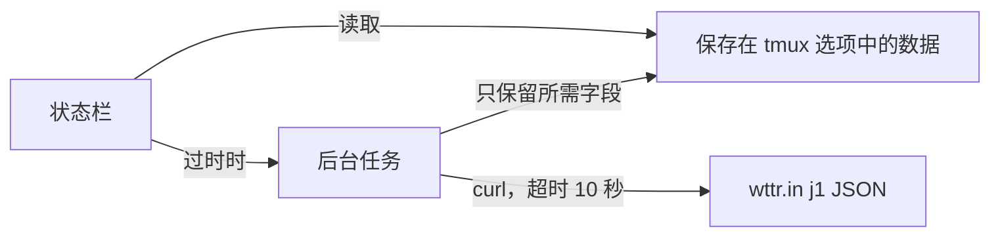

<div align="center">

# tmux-weather-revamped

<strong>在后台从 wttr.in 获取天气并显示在状态栏，状态栏无需等待。</strong>

[English](README.md) &nbsp;|&nbsp; [日本語](README.ja.md) &nbsp;|&nbsp; 简体中文 &nbsp;|&nbsp; [繁體中文（香港）](README.zh-HK.md)

[](https://github.com/tmux-revamped/tmux-weather-revamped/actions/workflows/tests.yml)
[](LICENSE)
[](CHANGELOG.md)

<p align="center">
  <a href="#功能">功能</a> &nbsp;|&nbsp;
  <a href="#环境要求">环境要求</a> &nbsp;|&nbsp;
  <a href="#安装">安装</a> &nbsp;|&nbsp;
  <a href="#用法">用法</a> &nbsp;|&nbsp;
  <a href="#配置">配置</a> &nbsp;|&nbsp;
  <a href="#快捷键">快捷键</a> &nbsp;|&nbsp;
  <a href="#工作原理">工作原理</a>
</p>

</div>

**28** 个状态占位符，每个地点只需 **1** 次 wttr.in 请求，默认每 **15** 分钟一次。获取失败时，屏幕上保留最后一次成功的数据。

---

## 功能

本插件在分离的后台任务中获取你所在地点的 wttr.in `j1` JSON，把需要的字段保存在一个 tmux 选项中，并从这份保存的副本渲染所有占位符。状态栏只读取保存的副本，因此无论网络是否可用都会立即返回。

| 占位符 | 输出 |
|:------------|:-------|
| `#{weather}` | 天气状况和温度，例如 `Partly cloudy +18°C` |
| `#{weather_temp}` | 去掉前导加号的温度，例如 `18°C` |
| `#{weather_feels_like}` | 体感温度，例如 `16` |
| `#{weather_wind}` | 风速和风向，例如 `11km/h NW` |
| `#{weather_humidity}` | 相对湿度，百分比 |
| `#{weather_pressure}` | 气压，单位 hPa |
| `#{weather_pressure_trend}` | 与上一次成功获取相比的 `^`、`v` 或 `=` |
| `#{weather_precip}` | 降水量，单位毫米 |
| `#{weather_rain_chance}` | 今天前八个预报时段中最高的降雨概率 |
| `#{weather_umbrella}` | 降雨概率达到阈值时显示的雨伞文本 |
| `#{weather_uv}` | 紫外线指数 |
| `#{weather_uv_color}` | 对应紫外线等级的 tmux 样式 |
| `#{weather_dew_point}` | 今天前八个预报时段的平均露点 |
| `#{weather_dew_comfort}` | `dry`、`comfortable`、`humid` 或 `oppressive` |
| `#{weather_moon}` | 月相，例如 `Waning Gibbous` |
| `#{weather_sunrise}` | 日出时间，例如 `06:00 AM` |
| `#{weather_sunset}` | 日落时间，例如 `06:45 PM` |
| `#{weather_forecast}` | 明天的最低和最高温度，例如 `15-27` |
| `#{weather_today_high}` | 今天的最高温度 |
| `#{weather_today_low}` | 今天的最低温度 |
| `#{weather_tomorrow_high}` | 明天的最高温度 |
| `#{weather_tomorrow_low}` | 明天的最低温度 |
| `#{weather_condition_icon}` | 表示天气状况的 Nerd Font Material Design 图标 |
| `#{weather_condition_tint}` | 对应天气状况的 tmux 样式 |
| `#{weather_color}` | 对应温度区间的 tmux 样式，例如 `#[fg=green]` |
| `#{weather_icon}` | 温度区间的图标，设置之前为空 |
| `#{weather_stale_color}` | 最后一次成功获取超过三个间隔时为 `#[dim]` |
| `#{weather_alert}` | 一行恶劣天气信息，未开启预警时为空 |

## 环境要求

| 工具 | 版本 | 用途 |
|:-----|:--------|:---------|
| tmux | 3.2 或更高 | 详情弹出窗口使用 `display-popup` |
| bash | 3.2 或更高 | 可用 macOS 的 `/bin/bash` |
| `curl` | 任意 | 每次获取，超时 10 秒 |
| 可访问 `wttr.in` 的网络 | | 天气数据来源 |

CI 在 Ubuntu LTS 的 x86_64 和 arm64 上使用 GNU 和 uutils coreutils 运行测试，在 macOS 的 Apple Silicon 和 Intel 上使用系统工具、GNU 工具和 uutils 运行测试。

## 安装

使用 [TPM](https://github.com/tmux-plugins/tpm) 时，把插件和一个占位符加入 `~/.tmux.conf`，然后按 `prefix + I`：

```tmux
set -g @plugin 'tmux-revamped/tmux-weather-revamped'
set -g status-right '#{weather} '
```

不使用 TPM 时，克隆仓库，并在设置 `status-right` 之后运行入口脚本：

```bash
git clone https://github.com/tmux-revamped/tmux-weather-revamped ~/.tmux/plugins/tmux-weather-revamped
```

```tmux
run-shell ~/.tmux/plugins/tmux-weather-revamped/weather-revamped.tmux
```

完整的配置示例见 [`examples/status-right.tmux.conf`](examples/status-right.tmux.conf)。

## 用法

设置一个地点，或留空让 wttr.in 根据 IP 定位：

```tmux
set -g @tmux-weather-location 'Sao Paulo'
set -g status-right '#{weather_color}#{weather_condition_icon} #{weather_temp}#[default] '
```

冷启动后的第一次渲染为空，直到第一次获取完成。使用同一份数据中的更多占位符可以得到更丰富的一行，而不增加请求：

```tmux
set -g status-right '#{weather_temp} #{weather_wind} #{weather_humidity}%% UV#{weather_uv} #{weather_forecast} '
```

### 温度区间

`#{weather_color}` 和 `#{weather_icon}` 读取当前温度所在区间的选项。无论显示单位是什么，区间都使用摄氏阈值。

| 区间 | 范围，°C | 默认颜色 |
|:-----|:------------|:--------------|
| `freezing` | 低于 0 | `#[fg=blue]` |
| `cold` | 0 到 9 | `#[fg=cyan]` |
| `cool` | 10 到 17 | `#[fg=green]` |
| `comfortable` | 18 到 23 | `#[fg=green]` |
| `hot` | 24 到 31 | `#[fg=yellow]` |
| `very_hot` | 32 及以上 | `#[fg=red]` |

每个区间读取 `@weather_revamped_<band>_color` 和 `@weather_revamped_<band>_icon`。图标默认为空，因此在设置之前不需要 Nerd Font。

### 天气状况

天气状况文本对应六个键之一，按以下顺序检查，因此雷阵雨属于 storm，雨夹雪属于 snow：

| 键 | 天气文本包含 | 默认色调 |
|:----|:-------------------|:-------------|
| `storm` | thunder、storm | `#[fg=magenta]` |
| `snow` | snow、sleet、blizzard、ice | `#[fg=white]` |
| `rain` | rain、drizzle、shower | `#[fg=blue]` |
| `fog` | fog、mist、haze | `#[fg=brightblack]` |
| `clouds` | cloud、overcast | `#[fg=brightblack]` |
| `clear` | 其他任何内容 | `#[fg=yellow]` |

设置 `@weather_revamped_<key>_condition_icon` 可更换图标，设置 `@weather_revamped_<key>_tint` 可更换色调。把色调选项设为空字符串即可关闭该色调。

### 多个地点

`@tmux-weather-locations` 接受以 `;` 分隔的列表。每个地点都有自己的后台获取和自己保存的数据。`#{weather*}` 占位符显示第一个地点。其他地点需带上地点名称调用脚本：

```tmux
set -g @tmux-weather-locations 'London;Tokyo;New York'
set -g status-right '#{weather_temp} #(~/.tmux/plugins/tmux-weather-revamped/src/weather.sh temp Tokyo) '
```

### 恶劣天气预警

预警默认关闭，并使用你选择的第二个端点。URL 中的 `{loc}` 会替换为地点。响应中第一个非空行会接在 `@weather_revamped_alert_prefix` 之后，成为 `#{weather_alert}`。

```tmux
set -g @tmux-weather-alerts 'on'
set -g @tmux-weather-alert-url 'https://example.com/alerts/{loc}'
set -g @weather_revamped_alert_prefix '[!] '
```

### 渲染模式与固定宽度

默认情况下每个占位符都变成一个 `#()` 调用，tmux 每次重绘状态栏都会重新运行它。把 `@weather_revamped_render` 设为 `options` 后，每个占位符变成对选项的读取，例如 `#{E:@weather_revamped_out_temp}`。每个服务器上的一个后台进程每隔 `@weather_revamped_interval` 秒渲染状态栏用到的所有值，并在一次 tmux 调用中写入。获取仍按自己的间隔进行。

`@weather_revamped_fixed_width 'on'` 会在 `#{weather_temp}` 左侧补齐到五个字符，因此从 `9°C` 变为 `12°C` 时，这一行的其余部分不会移动。`@weather_revamped_temp_width` 可直接设置宽度。

```tmux
set -g @weather_revamped_render 'options'
set -g @weather_revamped_fixed_width 'on'
```

### 诊断

```bash
~/.tmux/plugins/tmux-weather-revamped/src/weather.sh doctor
```

它会打印 `curl` 是否在 `PATH` 中、单位、间隔、是否开启预警、各个地点，以及保存数据的时长、温度和天气状况。

## 配置

| 选项 | 默认值 | 含义 |
|:-------|:--------|:--------|
| `@tmux-weather-location` | 空 | 城市或地点。为空时由 wttr.in 根据 IP 定位 |
| `@tmux-weather-locations` | 空 | 以 `;` 分隔的列表，优先于单个地点 |
| `@tmux-weather-units` | `m` | 公制。`u`、`f` 或 `fahrenheit` 把温度切换为华氏度、风速切换为 mph |
| `@tmux-weather-interval` | `15` | 获取间隔，单位为分钟 |
| `@tmux-weather-hide-units` | `off` | 设为 `on` 时从 `#{weather_temp}` 中去掉 `C` 或 `F` |
| `@tmux-weather-alerts` | `off` | 设为 `on` 时获取预警端点 |
| `@tmux-weather-alert-url` | 空 | 预警端点，`{loc}` 会替换为地点 |
| `@tmux-weather-popup-key` | `M-w` | 详情弹出窗口的前缀键。`off` 表示不绑定 |
| `@tmux-weather-refresh-key` | 空 | 立即获取的前缀键 |
| `@weather_revamped_show_condition_icon` | `on` | 设为 `off` 时 `#{weather_condition_icon}` 为空 |
| `@weather_revamped_<key>_condition_icon` | Material Design 图标 | 某个天气状况键的图标 |
| `@weather_revamped_<key>_tint` | 按键区分，见上文 | 某个天气状况键的样式 |
| `@weather_revamped_<band>_color` | 按区间区分，见上文 | 某个温度区间的样式 |
| `@weather_revamped_<band>_icon` | 空 | 某个温度区间的图标 |
| `@weather_revamped_umbrella_text` | 空 | `#{weather_umbrella}` 的文本。`{chance}` 会替换为降雨概率 |
| `@weather_revamped_umbrella_threshold` | `50` | 显示雨伞文本的降雨概率，百分比 |
| `@weather_revamped_alert_prefix` | 空 | `#{weather_alert}` 前的文本 |
| `@weather_revamped_stale_color` | `#[dim]` | 数据过时时 `#{weather_stale_color}` 输出的样式 |
| `@weather_revamped_pressure_delta` | `1` | 视为上升或下降的气压变化，单位 hPa |
| `@weather_revamped_pressure_rising` | `^` | 上升标记 |
| `@weather_revamped_pressure_falling` | `v` | 下降标记 |
| `@weather_revamped_pressure_steady` | `=` | 平稳标记 |
| `@weather_revamped_uv_low_color` | `#[fg=green]` | 紫外线 0 到 2 |
| `@weather_revamped_uv_moderate_color` | `#[fg=yellow]` | 紫外线 3 到 5 |
| `@weather_revamped_uv_high_color` | `#[fg=colour208]` | 紫外线 6 到 7 |
| `@weather_revamped_uv_very_high_color` | `#[fg=red]` | 紫外线 8 到 10 |
| `@weather_revamped_uv_extreme_color` | `#[fg=magenta]` | 紫外线 11 及以上 |
| `@weather_revamped_render` | 空 | 设为 `options` 开启渲染模式 |
| `@weather_revamped_interval` | `60` | 渲染模式每次运行的间隔，单位为秒 |
| `@weather_revamped_fixed_width` | `off` | 设为 `on` 时把温度补齐到五个字符 |
| `@weather_revamped_temp_width` | 空 | 温度的显式宽度 |

颜色使用 16 种 ANSI 名称，因此会跟随终端主题。若要固定确切色调，把区间选项设为十六进制值。

<details>
<summary><strong>六个主题的十六进制颜色</strong></summary>

```tmux
# Catppuccin Mocha
set -g @weather_revamped_freezing_color '#[fg=#89b4fa]'
set -g @weather_revamped_cold_color '#[fg=#94e2d5]'
set -g @weather_revamped_cool_color '#[fg=#a6e3a1]'
set -g @weather_revamped_comfortable_color '#[fg=#a6e3a1]'
set -g @weather_revamped_hot_color '#[fg=#f9e2af]'
set -g @weather_revamped_very_hot_color '#[fg=#f38ba8]'

# Dracula
set -g @weather_revamped_freezing_color '#[fg=#bd93f9]'
set -g @weather_revamped_cold_color '#[fg=#8be9fd]'
set -g @weather_revamped_cool_color '#[fg=#50fa7b]'
set -g @weather_revamped_comfortable_color '#[fg=#50fa7b]'
set -g @weather_revamped_hot_color '#[fg=#f1fa8c]'
set -g @weather_revamped_very_hot_color '#[fg=#ff5555]'

# Nord
set -g @weather_revamped_freezing_color '#[fg=#81a1c1]'
set -g @weather_revamped_cold_color '#[fg=#88c0d0]'
set -g @weather_revamped_cool_color '#[fg=#a3be8c]'
set -g @weather_revamped_comfortable_color '#[fg=#a3be8c]'
set -g @weather_revamped_hot_color '#[fg=#ebcb8b]'
set -g @weather_revamped_very_hot_color '#[fg=#bf616a]'

# Gruvbox Dark
set -g @weather_revamped_freezing_color '#[fg=#83a598]'
set -g @weather_revamped_cold_color '#[fg=#8ec07c]'
set -g @weather_revamped_cool_color '#[fg=#b8bb26]'
set -g @weather_revamped_comfortable_color '#[fg=#b8bb26]'
set -g @weather_revamped_hot_color '#[fg=#fabd2f]'
set -g @weather_revamped_very_hot_color '#[fg=#fb4934]'

# Tokyo Night
set -g @weather_revamped_freezing_color '#[fg=#7aa2f7]'
set -g @weather_revamped_cold_color '#[fg=#7dcfff]'
set -g @weather_revamped_cool_color '#[fg=#9ece6a]'
set -g @weather_revamped_comfortable_color '#[fg=#9ece6a]'
set -g @weather_revamped_hot_color '#[fg=#e0af68]'
set -g @weather_revamped_very_hot_color '#[fg=#f7768e]'

# Solarized Dark
set -g @weather_revamped_freezing_color '#[fg=#268bd2]'
set -g @weather_revamped_cold_color '#[fg=#2aa198]'
set -g @weather_revamped_cool_color '#[fg=#859900]'
set -g @weather_revamped_comfortable_color '#[fg=#859900]'
set -g @weather_revamped_hot_color '#[fg=#b58900]'
set -g @weather_revamped_very_hot_color '#[fg=#dc322f]'
```

</details>

### 内部状态

这些选项由插件自行管理，请勿设置。

| 选项 | 保存内容 |
|:-------|:------|
| `@weather_revamped_value_<location>` | 一个地点保存的数据，并带有表示其时效和进行中获取的 `_ts` 与 `_lock` |
| `@weather_revamped_alert_<location>` | 一个地点保存的预警行 |
| `@weather_revamped_<location>_ok_ts` | 最后一次成功获取的时间，由 `#{weather_stale_color}` 读取 |
| `@weather_revamped_<location>_pressure_prev` | 上一次成功获取的气压，由趋势判断读取 |
| `@weather_revamped_published` | 状态栏用到的占位符，在加载时记录，使渲染模式只发布这些 |
| `@weather_revamped_out_<name>` | 渲染模式下渲染出的每个值 |
| `@weather_revamped_ticker_pid` | 负责渲染模式的进程 |
| `@weather_revamped_option_names` | 渲染模式每次运行时通过一次 tmux 调用读取的选项 |

`<location>` 是把地点名称中 `A-Z`、`a-z`、`0-9` 和 `_` 以外的字符都替换为 `_` 的结果，地点为空时为 `auto`。

## 快捷键

| 按键 | 选项 | 动作 |
|:----|:-------|:-------|
| `prefix + M-w` | `@tmux-weather-popup-key` | 打开根据第一个地点的保存数据生成的卡片 |
| 不绑定 | `@tmux-weather-refresh-key` | 立即获取第一个地点 |

卡片显示天气状况、温度和体感温度、风、湿度、气压、紫外线、露点及其舒适度、降水量和降雨概率、日出、日落、月相，以及今天和明天的温度范围。它只读取保存的副本，不发出请求。

## 工作原理



加载时，[`weather-revamped.tmux`](weather-revamped.tmux) 把状态栏中的每个占位符替换为对 [`src/weather.sh`](src/weather.sh) 的调用，或在渲染模式下替换为对选项的读取，并绑定按键。每次渲染都会检查保存数据的时长。超过 `@tmux-weather-interval` 时，一个分离的子 shell 获取锁并开始获取，渲染则不等待，直接返回保存的副本。锁在 20 秒后过期，因此中途终止的获取不会阻塞下一次获取。

包含 `Unknown location`、`ERROR` 或 `Sorry` 的响应会被丢弃，保留之前的数据。成功的响应会精简为插件读取的 22 个 JSON 字段，使保存的副本约为 9 KB，而不是 wttr.in 发送的约 40 KB。天气状况文本和预警行中的每个 `#` 在到达状态栏之前都会被加倍，因此响应无法作为 tmux 格式执行。

## 开发

| 命令 | 运行内容 |
|:--------|:-------------|
| `make test` | bats 测试套件 |
| `make lint` | 对所有 shell 文件运行 warning 级别的 shellcheck |
| `make coverage` | kcov 行覆盖率，下限 95%，仅 Linux |
| [`family/bin/audit`](family/bin/audit) | 按系列约定检查本仓库 |

## 许可证

[MIT](LICENSE)，copyright Gustavo Franco。天气数据来自 [wttr.in](https://github.com/chubin/wttr.in)。灵感来自 [tmux-weather](https://github.com/ilya-manin/tmux-weather)。

<!-- family:begin -->

## tmux-revamped 系列

本插件是 tmux-revamped 系列的成员之一。每个成员都带有 [`FAMILY.md`](FAMILY.md) 中的同一份约定、`family/` 下的同一套工具和同一个共享库，并由校验和清单保持逐字节一致。这些成员按一起安装来设计：一个成员占用的按键或 tmux 选项，不会被另一个成员占用。

在一个成员中发现的缺陷，要在所有成员中排查之后才算修复完成。这项义务写在约定里而不是靠记忆，`family/bin/sweep` 就是履行它的方式。

| 成员 | 功能 |
|---|---|
| [`tmux-autoreload-revamped`](https://github.com/tmux-revamped/tmux-autoreload-revamped) | 编辑并保存 tmux 配置后自动重新加载，无需按键或命令 |
| [`tmux-battery-revamped`](https://github.com/tmux-revamped/tmux-battery-revamped) | 在状态栏显示电池状态，不阻塞状态栏渲染 |
| [`tmux-bluetooth-revamped`](https://github.com/tmux-revamped/tmux-bluetooth-revamped) | 在状态栏显示每个已连接的蓝牙设备及其电量，不阻塞渲染 |
| [`tmux-cpu-revamped`](https://github.com/tmux-revamped/tmux-cpu-revamped) | 在状态栏显示 CPU 负载、温度和频率，不阻塞渲染 |
| [`tmux-disk-revamped`](https://github.com/tmux-revamped/tmux-disk-revamped) | 在状态栏显示磁盘用量，不阻塞状态栏渲染 |
| [`tmux-extract-revamped`](https://github.com/tmux-revamped/tmux-extract-revamped) | 用 fzf 从屏幕上选取 URL、路径、哈希或其他文本并输入到光标处，纯 shell 实现 |
| [`tmux-fzf-revamped`](https://github.com/tmux-revamped/tmux-fzf-revamped) | 在弹出窗口的 fzf 选择器中切换、关闭、重命名或创建 tmux 会话、窗口和窗格 |
| [`tmux-git-revamped`](https://github.com/tmux-revamped/tmux-git-revamped) | 在状态栏显示当前窗格的 git 分支、改动和托管平台计数，不阻塞状态栏 |
| [`tmux-gpu-revamped`](https://github.com/tmux-revamped/tmux-gpu-revamped) | 在状态栏显示 NVIDIA、AMD、Intel 和 Apple GPU 的负载、温度、频率、功耗和显存 |
| [`tmux-kube-revamped`](https://github.com/tmux-revamped/tmux-kube-revamped) | 在状态栏显示当前 Kubernetes 上下文和命名空间，直接解析 kubeconfig，无需 kubectl |
| [`tmux-launcher-revamped`](https://github.com/tmux-revamped/tmux-launcher-revamped) | 以当前窗格的目录，在弹出窗口或新窗口中启动任意 TUI 应用 |
| [`tmux-logging-revamped`](https://github.com/tmux-revamped/tmux-logging-revamped) | 将任意窗格保存到文件：实时记录、完整回滚缓冲区或一次性截图 |
| [`tmux-music-revamped`](https://github.com/tmux-revamped/tmux-music-revamped) | 在状态栏显示正在播放的音乐，不阻塞状态栏渲染 |
| [`tmux-network-revamped`](https://github.com/tmux-revamped/tmux-network-revamped) | 在状态栏显示网络吞吐量，不阻塞渲染 |
| [`tmux-pain-control-revamped`](https://github.com/tmux-revamped/tmux-pain-control-revamped) | 标准的 tmux 窗格和窗口管理快捷键，区分版本、兼容 vim，并且全部可配置 |
| [`tmux-persist-revamped`](https://github.com/tmux-revamped/tmux-persist-revamped) | 保存所有 tmux 会话、窗口和窗格，按定时器自动保存，重启后全部恢复 |
| [`tmux-plugin-template`](https://github.com/tmux-revamped/tmux-plugin-template) | tmux-revamped 插件的起点：共享库、bats 测试框架、CI 和系列工具 |
| [`tmux-pomodoro-revamped`](https://github.com/tmux-revamped/tmux-pomodoro-revamped) | 状态栏中的番茄钟，所有状态都保存在 tmux 选项中，不使用临时文件 |
| [`tmux-ram-revamped`](https://github.com/tmux-revamped/tmux-ram-revamped) | 在后台采样 RAM、交换区和内存压力并显示在状态栏，渲染无需等待 |
| [`tmux-reorder-revamped`](https://github.com/tmux-revamped/tmux-reorder-revamped) | 用鼠标沿状态栏拖动窗口标签来移动该窗口 |
| [`tmux-scroll-revamped`](https://github.com/tmux-revamped/tmux-scroll-revamped) | 把鼠标滚轮交给自行滚动的应用，其他情况进入 tmux 复制模式 |
| [`tmux-sensible-revamped`](https://github.com/tmux-revamped/tmux-sensible-revamped) | 按 tmux 版本和终端区分的合理默认设置，不改动你自己设置的选项 |
| [`tmux-tiling-revamped`](https://github.com/tmux-revamped/tmux-tiling-revamped) | tmux 的平铺窗口管理：八种布局，包括 BSP dwindle 和 spiral，并支持撤销布局 |
| [`tmux-time-revamped`](https://github.com/tmux-revamped/tmux-time-revamped) | 状态栏中的本地时钟和世界时钟，按一天中的时段着色，并提供倒计时和夏令时提醒 |
| [`tmux-weather-revamped`](https://github.com/tmux-revamped/tmux-weather-revamped) | **本插件**，在后台从 wttr.in 获取天气并显示在状态栏，状态栏无需等待 |

### 检查安装

所有成员都在磁盘上时，一条命令即可报告它们之间的冲突：

```sh
family/bin/doctor --live
```

它读取每个成员和正在运行的 tmux 服务器，报告重复的按键、重复的状态占位符、不符合命名规则的选项，以及约定版本落后的成员。

<!-- family:end -->
